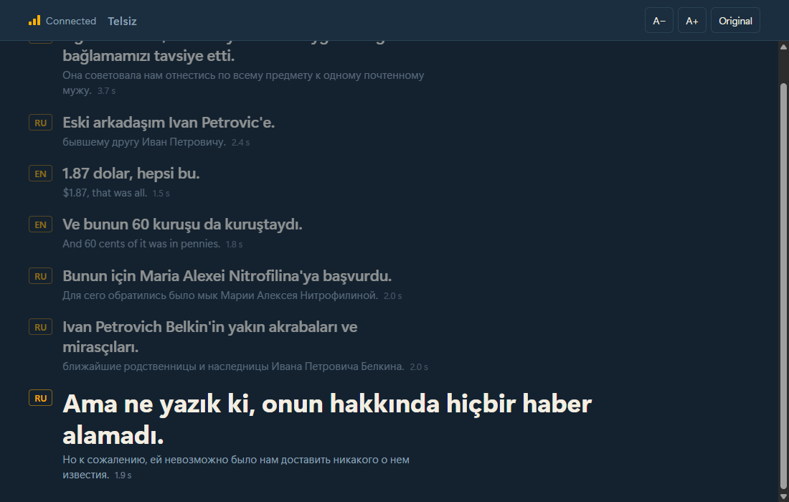
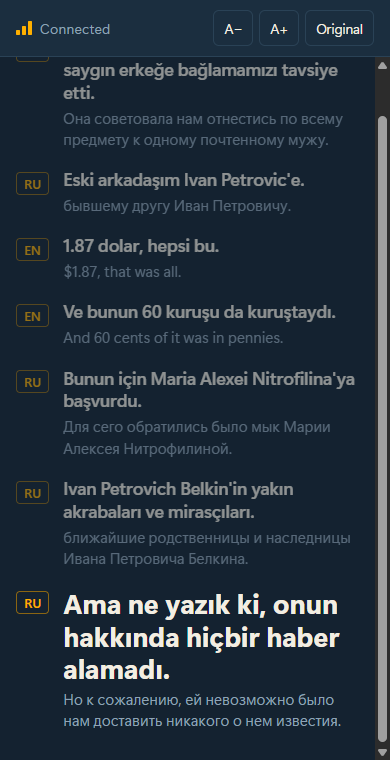

# Telsiz

[🇹🇷 Türkçe](#turkce) | [🇬🇧 English](#english)

---

<a id="turkce"></a>

## 🇹🇷 Türkçe

> Real-time voice chat translator for CS2

### Telsiz nedir?

Telsiz, Counter-Strike 2 oynarken takım arkadaşlarının **sesli sohbetini** dinleyen, konuşulan dili (İngilizce, Rusça, Ukraynaca, Lehçe vb.) tespit eden ve seçtiğin dile (varsayılan: Türkçe) çevirip **yazı olarak** gösteren bir masaüstü uygulamasıdır.

Çeviriyi iki yerde görebilirsin (ikisi aynı anda açık olabilir):

1. **İkinci ekran:** Bilgisayardaki bir tarayıcı sekmesi (`http://127.0.0.1:8765/`), örneğin ikinci monitörde
2. **Telefon:** Aynı Wi‑Fi ağında, QR kod okutularak açılan bir web sayfası

Telsiz çeviriyi oyunun üstünde göstermez; oyun ekranına hiçbir şey çizilmez. Tek monitörle oynuyorsan çevirileri telefondan izle: oyun öndeyken bilgisayardaki sayfa oyunun arkasında kalır.

Telsiz yalnızca sesli sohbetle ilgilenir; yazılı sohbeti çevirmez.

<p>
  
  
</p>

### Kurulum

1. [Releases](https://github.com/YusufOzturk00/telsiz/releases) sayfasından `Telsiz-…-windows-x64.zip` dosyasını indir ve bir klasöre çıkar.
2. **Telsiz.exe**'ye çift tıkla. CS2'yi dinlemeye başlar ve çeviriler bu bilgisayarın tarayıcısında açılır. CS2 kapalıysa açılmasını bekler.
3. Telefonda görmek için onun yerine **Telsiz - Telefon**'u çalıştır ve konsoldaki QR kodu okut. Telefon aynı Wi‑Fi ağında olmalı. Windows, Telsiz'in ağı kullanmasına izin isteyebilir: yalnızca **özel ağlar** için izin ver.

- İlk açılışta modeller bir kez indirilir: bilgisayarının RAM'ine göre ~1–2 GB. Sonraki açılışlar birkaç saniye sürer.
- Program imzalı olmadığı için Windows "Bilgisayarınız korundu" uyarısı verebilir: **Ek bilgi → Yine de çalıştır**.
- Kapatmak için konsolda **Ctrl+C**'ye bas.
- Ayarları değiştirmek için `config.example.toml` dosyasını aynı klasörde `config.toml` adıyla kopyalayıp düzenle; dosyadaki açıklamalar her ayarı anlatır.

### Bilmen gerekenler

- **Ekran modu:** Çeviriler en tutarlı **Tam Ekran Pencereli** modda geldi. **Tam Ekran** modunda testlerimizde tutarsız çalıştı (bazı oturumlarda çeviriler çok seyrek geldi); bu yüzden **Tam Ekran Pencereli** öneriyoruz.
- **Alt-tab:** CS2 arka plana alınınca kendi sesini kapatır. Çevrilecek ses olmadığı için alt-tab yaptığında çeviri gelmez; oyuna dönünce devam eder.
- **Yalnızca oyunun sesi:** Telsiz yalnızca `cs2.exe`'nin sesini dinler; arka planda çalan müzik, videolar ve Discord çevrilmez. Bunu `telsiz-loopback.exe` adlı küçük yardımcı program yapar. Windows sürümün bunu desteklemiyorsa Telsiz bunu konsolda söyler ve bilgisayarda çalan **bütün sesi** dinlemeye geçer.
- **Hız:** Bir satır, konuşma bittikten genellikle ~2 saniye sonra gelir (önceki sürümde ~3 saniye). Whisper her ses parçasını 30 saniyelik bir pencereye tamamlıyordu; parçalar en fazla birkaç saniye olduğu için Telsiz artık 10 saniyelik pencere kullanır. Aynı isabette tanıma 4 kat hızlandı. Whisper emin olamadığı bir cümleyi 5 kez daha baştan çözmeyi denerdi; oyunda bu satırların ~%27'sinde oluyor ve onları ~4,7 saniyeye çıkarıyordu. Metin iyileşmediği için Telsiz her cümleyi bir kez çözer.
- **Oyun sesinde konuşmayı yakalama:** Bir takım arkadaşının sesi net başlar, sonra oyun sesinin altında kalır. Telsiz bir konuşmayı yine net bir sesle başlatır, ama sonrasında zayıflayan kısmı da konuşma sayar; eskiden bu cümlelerin çoğu yarıda kesiliyor ya da tamamen atlanıyordu. Yalnızca oyun sesinin olduğu bir bot maçında bu başlangıç eşiğine saniyelerin %1'inde ulaşıldı; gerçek maçlarda %44–60'ında.
- **Hep canlı kalır:** Telsiz bir sebeple 5 saniyeden fazla geride kalırsa birikmiş sesi atlar ve canlı sese döner; geç gelen bir uyarı oyunda işe yaramaz. Bu süre `config.toml` içinde `[performance]` bölümündeki `max_lag_s` ile değiştirilebilir (`0` = hiç atlama).
- **Oyun önce gelir:** Telsiz en fazla 4 işlemci çekirdeği kullanır ve kimse konuşmazken neredeyse hiç kaynak kullanmaz. Oyunu dinlerken konuşma tanıma **işlemcide** yapılır: maç sırasında CS2 ekran kartını o kadar doldurur ki, ekran kartında 4 saniyelik bir cümlenin tanınması ~26 saniye sürdü (işlemcide ~3 saniye, önceki sürümle). Ekran kartı oyuna kalır. İşlem önceliği bilerek normal bırakılır; düşük öncelikte tanıma CS2'nin arkasında takılıyordu.
- **Doğruluk modu:** Varsayılan model `small`, hızlı ve hafiftir. Daha isabetli tanıma için `config.toml` içinde `[asr]` bölümüne `model = "large-v3-turbo"` yaz: test kayıtlarında kelime hata oranı %38 yerine %26, ama her parça ~0,4 yerine ~2,2 saniye sürer ve işlemciyi daha çok kullanır (ilk kullanımda 1,6 GB indirir).
- **Çeviri:** Kurulu RAM'e göre seçilir: 24 GB ve üstü **NLLB-200 1.3B** (en iyi kalite), 12–16 GB **NLLB-200 600M**, daha azı **Argos Translate** (en hafif). Çeviri her zaman işlemcide çalışır. NLLB Rusça ve Ukraynacayı İngilizceye uğramadan doğrudan Türkçeye çevirir. Oyun terimleri (AWP, eco, A long…) çevrilmeden kalır ve kısaltmalar (nt, gg…) açılır; sözlük [data/glossary.toml](data/glossary.toml) dosyasında.
- **NLLB lisansı:** NLLB-200 model ağırlıklarının lisansı **CC-BY-NC-4.0**'dır, yani yalnızca ticari olmayan kullanıma izin verir. Telsiz'in kodu MIT lisanslıdır; NLLB modeli Telsiz ile dağıtılmaz, ilk kullanımda indirilir.
- **Gizlilik:** Ses diske yazılmaz ve bilgisayarından dışarı çıkmaz. Tanıma ve çeviri yereldir; telemetri yoktur. Telefon modu yalnızca yerel ağda çalışır ve bağlantıda bu oturuma özel rastgele bir erişim anahtarı vardır; anahtarı olmayan cihazlar reddedilir.
- Konsolda her satır için uçtan uca gecikme yazılır (konuşma bitişinden ekrana). Ölçüm raporları [docs/eval](docs/eval) klasöründe.

### SSS

**Çeviriler oyunun üstünde görünür mü?**
Hayır. Telsiz oyun ekranına hiçbir şey çizmez; çevirileri telefonda veya ikinci ekrandaki tarayıcıda izlersin. Bu yüzden çözünürlük, 4:3 veya ölçek ayarları fark etmez.

**VAC veya FACEIT'ten ban riski var mı?**
Telsiz oyuna hiçbir şekilde dokunmaz: oyunun belleğini okumaz, oyuna kod enjekte etmez, oyun dosyalarını değiştirmez, oyuna tuş göndermez. Yalnızca OBS ve Discord'un da kullandığı Windows ses API'leriyle oyunun sesini dinler. Ayrıntılar aşağıda, "Neden güvenli?" bölümünde.

**Tam Ekran'da çalışır mı?**
Çalışır, ama testlerimizde tutarsızdı. En iyi sonuç için **Tam Ekran Pencereli** kullan.

**Alt-tab yapınca neden çeviri gelmiyor?**
CS2 arka plana alınınca kendi sesini kapatır; çevrilecek ses yoktur. Oyuna dönünce çeviriler devam eder.

**Antivirüsüm veya Windows uyarı veriyor.**
Program imzalı değildir ve PyInstaller ile paketlenen programlar bazen yanlışlıkla işaretlenir. Paket, açık kaynak koddan GitHub Actions'ta derlenir; istersen kaynak koddan kendin çalıştırabilir veya paketleyebilirsin (aşağıda).

**Telefon bağlanmıyor.**
Telefon bilgisayarla aynı Wi‑Fi ağında olmalı. **Telsiz - Telefon** ile başlat ve Windows ağ izni sorarsa **özel ağlar** için izin ver. QR koddaki bağlantı yalnızca o oturumda geçerlidir; Telsiz'i yeniden başlatınca yeni QR kodu okut.

**Çeviriler bazen yanlış.**
Sesli sohbet sıkıştırılmış ve gürültülüdür, varsayılan `small` modeli de hız için seçilmiştir. Daha isabetli tanıma için doğruluk moduna geç (yukarıda). Yanlış çevrilen oyun terimleri için sözlüğe ekleme önerebilirsin.

### Neden güvenli?

Telsiz, VAC, FACEIT AC ve diğer anti-cheat sistemleri açısından **sıfır risk** taşıyacak şekilde tasarlanmıştır. Oyuna hiçbir şekilde dokunmaz; yalnızca Windows'un, OBS ve Discord'un da kullandığı standart ses API'lerini kullanır.

**Telsiz'in asla yapmadığı şeyler:**

- `cs2.exe` (veya herhangi bir oyun süreci) üzerinde `OpenProcess`, `ReadProcessMemory`, `WriteProcessMemory`, `VirtualAllocEx`, `CreateRemoteThread` vb. çağırmak
- DLL enjeksiyonu, DirectX/Vulkan/DXGI hook'u, `SetWindowsHookEx` ile oyuna global hook
- Oyun dosyalarını, config'lerini (`.cfg`) veya `.vpk` dosyalarını değiştirmek
- Kernel sürücüsü yüklemek veya kullanmak
- Oyuna tuş veya fare girdisi göndermek (`SendInput`, `keybd_event` vb.)
- Oyun belleğinden offset veya pattern okuyan herhangi bir kütüphane kullanmak
- Kendini gizlemek (süreç gizleme, string şifreleme, "undetected" tarzı teknikler). Telsiz şeffaf ve masum görünür, çünkü masumdur.

**Telsiz'in kullandığı yöntemler:**

- **Ses:** Windows WASAPI loopback capture (sistem geneli) ve **Application/Process Loopback** (`ActivateAudioInterfaceAsync` + `AUDIOCLIENT_ACTIVATION_TYPE_PROCESS_LOOPBACK`). Bu, OBS ve Discord'un kullandığı işletim sistemi seviyesindeki API'dir; oyun sürecine dokunmaz. Oyunun süreç kimliğini (PID) bulmak için yalnızca süreç listesi okunur (Windows Görev Yöneticisi'nin de gösterdiği liste, `CreateToolhelp32Snapshot`). Bu bir **liste okuma** işlemidir, süreç açılmaz. PID yalnızca Windows ses motoruna "bu programın sesini ver" demek için kullanılır. Bu işi yapan `telsiz-loopback.exe`, Microsoft'un açık kaynak ApplicationLoopback örneğine dayanır ve kaynak kodundan derlenir.
- **Görüntü:** Çeviriler yalnızca Telsiz'in kendi web sayfasında (tarayıcı veya telefon) gösterilir. Oyunun ekranına hiçbir şey çizilmez, oyunun penceresine dokunulmaz.
- **(İleride, opsiyonel)** Valve'ın resmi **Game State Integration (GSI)** özelliği (oyunun kendi paylaştığı raund bilgisi).

Kaynak kodun tamamı açıktır; bu iddiaları kendin doğrulayabilirsin.

### Gereksinimler

- Windows 10 2004 (build 19041) veya üstü, 64-bit
- Disk: program için ~350 MB, modeller için ~1–2 GB
- Kaynak koddan çalıştırmak için Python 3.11 veya üstü

### Kaynak koddan çalıştırma ve geliştirme

```powershell
git clone https://github.com/YusufOzturk00/telsiz.git
cd telsiz
python -m venv .venv
.venv\Scripts\Activate.ps1
pip install -e ".[all,dev]"
python -m telsiz --live
```

Telefonda da görmek için `python -m telsiz --live --phone`, ayar dosyası için `--config config.toml`, bütün bilgisayar sesini dinlemek için `--capture system`, başka bir programla denemek için `--app` kullan (ör. tarayıcıda Rusça bir video açıp `python -m telsiz --live --app chrome.exe`). Bir ses dosyasını çevirmek için: `python -m telsiz --input tests/fixtures/en_magi_1.wav --target tr`. NVIDIA ekran kartında oyun dışında tanıma için `pip install -e ".[gpu]"`.

`telsiz-loopback.exe` açık kaynak kodundan ([native/process_loopback](native/process_loopback)) GitHub Actions'ta derlenir; repoda hazır exe tutulmaz. Son derlenmiş halini şöyle indirebilirsin ([GitHub CLI](https://cli.github.com/) gerekir):

```powershell
$run = gh run list --repo YusufOzturk00/telsiz --workflow ci.yml --branch main --status success -L 1 --json databaseId -q ".[0].databaseId"
```

```powershell
gh run download $run --repo YusufOzturk00/telsiz -n telsiz-loopback -D native/process_loopback/build/Release
```

Ya da kendin derle: CMake ve Visual Studio Build Tools (C++) gerekir; adımlar [native/process_loopback/README.md](native/process_loopback/README.md) dosyasında.

Kontroller:

```powershell
ruff check .
ruff format --check .
pytest
```

Gerçek modelle çalışan yavaş testler `@pytest.mark.slow` ile işaretlidir ve varsayılan olarak atlanır; `pytest -m slow` ile çalıştır (ilk çalıştırma modelleri indirir).

Paketi oluşturmak için önce `telsiz-loopback.exe`'yi derle, sonra `pip install -e ".[all,package]"` ve `python scripts/build_package.py` çalıştır; `dist` klasöründe zip oluşur. CI her değişiklikte paketi derler. `v1.0.0` gibi bir etiket gönderilince paket GitHub Releases'a eklenir.

### Lisans

[MIT](LICENSE). Paketteki açık kaynak bileşenler `THIRD_PARTY_NOTICES.txt` dosyasında listelenir.

### Marka notu

Counter-Strike ve CS2, Valve Corporation'ın ticari markalarıdır. Telsiz'in Valve ile herhangi bir bağlantısı yoktur ve Valve tarafından onaylanmamıştır.

---

<a id="english"></a>

## 🇬🇧 English

> Real-time voice chat translator for CS2

### What is Telsiz?

Telsiz is a desktop application that listens to your teammates' **voice chat** while you play Counter-Strike 2, detects the spoken language (English, Russian, Ukrainian, Polish, etc.), translates it into the language you choose (default: Turkish) and shows it **as text**.

You can see the translation in two places (both can be open at the same time):

1. **Second screen:** A browser tab on your PC (`http://127.0.0.1:8765/`), for example on a second monitor
2. **Phone:** A web page on the same Wi‑Fi network, opened by scanning a QR code

Telsiz does not show the translation on top of the game; nothing is drawn on the game screen. If you play on one monitor, watch the translations on your phone: while the game is in front, the page on your PC is hidden behind it.

Telsiz only deals with voice chat; it does not translate text chat.

<p>
  
  
</p>

### Installation

1. Download `Telsiz-…-windows-x64.zip` from the [Releases](https://github.com/YusufOzturk00/telsiz/releases) page and extract it to a folder.
2. Double-click **Telsiz.exe**. It starts listening to CS2, and the translations open in a browser on this PC. If CS2 is closed, it waits for the game to start.
3. To see them on your phone, run **Telsiz - Telefon** instead and scan the QR code in the console. The phone must be on the same Wi‑Fi network. Windows may ask whether Telsiz may use the network: allow it for **private networks** only.

- The models are downloaded once, on first start: ~1–2 GB depending on your PC's RAM. Later starts take a few seconds.
- The program is not signed, so Windows may show "Windows protected your PC": **More info → Run anyway**.
- To quit, press **Ctrl+C** in the console.
- To change settings, copy `config.example.toml` to `config.toml` in the same folder and edit it; the comments in the file explain each setting.

### Things to know

- **Display mode:** Translations were most consistent in **Fullscreen Windowed** mode. In **Fullscreen** mode Telsiz worked inconsistently in our tests (in some sessions translations came very rarely), so we recommend **Fullscreen Windowed**.
- **Alt-tab:** CS2 mutes its own audio when it goes to the background. With no audio to translate, no translations arrive while you are alt-tabbed; they continue when you return to the game.
- **Only the game's audio:** Telsiz listens only to `cs2.exe`'s audio; music, videos and Discord playing in the background are not translated. A small helper program, `telsiz-loopback.exe`, does this. If your Windows version does not support it, Telsiz says so in the console and switches to listening to **all audio** playing on your PC.
- **Speed:** A line usually arrives ~2 seconds after the speech ends (~3 seconds in the previous version). Whisper padded every sound clip to a 30-second window; since clips are at most a few seconds long, Telsiz now uses a 10-second window. Recognition got 4 times faster at the same accuracy. Whisper used to try decoding a sentence it was unsure about again up to 5 more times; in the game this happened on ~27% of lines and pushed them to ~4.7 seconds. Because the text did not improve, Telsiz decodes each sentence once.
- **Catching speech under game sound:** A teammate's voice starts clearly, then sinks under the game sound. Telsiz still starts an utterance only on a clear voice, but then counts the weaker part as speech too; before, most of these sentences were cut short or skipped entirely. In a bot match with only game sound, this start threshold was reached in 1% of seconds; in real matches, in 44–60%.
- **Always live:** if Telsiz falls more than 5 seconds behind for any reason, it skips the backlog and returns to live audio; a late warning is useless in a game. Change this with `max_lag_s` in the `[performance]` section of `config.toml` (`0` = never skip).
- **The game comes first:** Telsiz uses at most 4 CPU cores and almost no resources while nobody speaks. While listening to the game, speech recognition runs on the **processor**: during a match CS2 keeps the graphics card so busy that recognizing a 4-second sentence on the card took ~26 seconds (~3 seconds on the processor, with the previous version). The graphics card is left to the game. The process priority is deliberately left at normal; at a lower priority, recognition stalled behind CS2.
- **Accuracy mode:** The default model, `small`, is fast and light. For more accurate recognition, write `model = "large-v3-turbo"` in the `[asr]` section of `config.toml`: on the test recordings the word error rate is 26% instead of 38%, but each clip takes ~2.2 instead of ~0.4 seconds and uses more of the processor (downloads 1.6 GB on first use).
- **Translation:** Chosen by installed RAM: 24 GB or more **NLLB-200 1.3B** (best quality), 12–16 GB **NLLB-200 600M**, less **Argos Translate** (lightest). Translation always runs on the processor. NLLB translates Russian and Ukrainian straight into Turkish without going through English. Game terms (AWP, eco, A long…) stay untranslated and abbreviations (nt, gg…) are expanded; the glossary is in [data/glossary.toml](data/glossary.toml).
- **NLLB license:** the NLLB-200 model weights are licensed **CC-BY-NC-4.0**, which allows non-commercial use only. Telsiz's code is MIT-licensed; the NLLB model is not distributed with Telsiz and is downloaded on first use.
- **Privacy:** Audio is never written to disk and never leaves your PC. Recognition and translation are local; there is no telemetry. Phone mode only works on the local network, and the link contains a random access key for this session only; devices without the key are refused.
- The console shows the end-to-end latency of every line (from the end of speech to the screen). Measurement reports are in the [docs/eval](docs/eval) folder.

### FAQ

**Do the translations appear on top of the game?**
No. Telsiz draws nothing on the game screen; you read the translations on your phone or in a browser on a second screen. So resolution, 4:3 or scaling settings make no difference.

**Is there a risk of a VAC or FACEIT ban?**
Telsiz never touches the game: it does not read the game's memory, inject code into the game, modify game files or send keys to the game. It only listens to the game's audio through the Windows audio APIs that OBS and Discord also use. Details are below, in "Why is this safe?".

**Does it work in Fullscreen?**
It works, but it was inconsistent in our tests. For the best results use **Fullscreen Windowed**.

**Why do no translations arrive when I alt-tab?**
CS2 mutes its own audio when it goes to the background; there is no audio to translate. Translations continue when you return to the game.

**My antivirus or Windows shows a warning.**
The program is not signed, and programs packaged with PyInstaller are sometimes flagged by mistake. The package is built from the open source code on GitHub Actions; if you prefer, you can run or package it from source yourself (below).

**The phone does not connect.**
The phone must be on the same Wi‑Fi network as the PC. Start with **Telsiz - Telefon**, and if Windows asks for network access, allow it for **private networks**. The link in the QR code is only valid for that session; after restarting Telsiz, scan the new QR code.

**Translations are sometimes wrong.**
Voice chat is compressed and noisy, and the default `small` model was chosen for speed. For more accurate recognition, switch to accuracy mode (above). For game terms that are translated wrongly, you can suggest additions to the glossary.

### Why is this safe?

Telsiz is designed to carry **zero risk** with respect to VAC, FACEIT AC and other anti-cheat systems. It never touches the game in any way; it only uses the standard Windows audio APIs that OBS and Discord also use.

**Things Telsiz never does:**

- Calling `OpenProcess`, `ReadProcessMemory`, `WriteProcessMemory`, `VirtualAllocEx`, `CreateRemoteThread`, etc. on `cs2.exe` (or any game process)
- DLL injection, DirectX/Vulkan/DXGI hooks, global hooks into the game with `SetWindowsHookEx`
- Modifying game files, configs (`.cfg`) or `.vpk` files
- Loading or using a kernel driver
- Sending keyboard or mouse input to the game (`SendInput`, `keybd_event`, etc.)
- Using any library that reads offsets or patterns from game memory
- Hiding itself (process hiding, string encryption, "undetected"-style techniques). Telsiz looks transparent and innocent, because it is innocent.

**Methods Telsiz uses:**

- **Audio:** Windows WASAPI loopback capture (system-wide) and **Application/Process Loopback** (`ActivateAudioInterfaceAsync` + `AUDIOCLIENT_ACTIVATION_TYPE_PROCESS_LOOPBACK`). This is the operating-system-level API that OBS and Discord use; it does not touch the game process. To find the game's process ID (PID), only the process list is read (the list Windows Task Manager also shows, `CreateToolhelp32Snapshot`). This is a **list read**; no process is opened. The PID is only used to tell the Windows audio engine "give me this program's audio". `telsiz-loopback.exe`, which does this, is based on Microsoft's open-source ApplicationLoopback sample and is built from source.
- **Display:** Translations are shown only on Telsiz's own web page (browser or phone). Nothing is drawn on the game screen, and the game's window is never touched.
- **(Later, optional)** Valve's official **Game State Integration (GSI)** feature (the round information the game itself shares).

All of the source code is open; you can verify these claims yourself.

### Requirements

- Windows 10 2004 (build 19041) or later, 64-bit
- Disk: ~350 MB for the program, ~1–2 GB for the models
- Python 3.11 or later to run from source

### Running from source and development

```powershell
git clone https://github.com/YusufOzturk00/telsiz.git
cd telsiz
python -m venv .venv
.venv\Scripts\Activate.ps1
pip install -e ".[all,dev]"
python -m telsiz --live
```

Use `python -m telsiz --live --phone` to see the translations on your phone too, `--config config.toml` for a settings file, `--capture system` to listen to all PC audio, and `--app` to try it with another program (e.g. open a Russian video in the browser and run `python -m telsiz --live --app chrome.exe`). To translate an audio file: `python -m telsiz --input tests/fixtures/en_magi_1.wav --target tr`. For recognition on an NVIDIA graphics card outside the game: `pip install -e ".[gpu]"`.

`telsiz-loopback.exe` is built from its open source code ([native/process_loopback](native/process_loopback)) on GitHub Actions; no prebuilt exe is kept in the repository. You can download the latest build like this ([GitHub CLI](https://cli.github.com/) required):

```powershell
$run = gh run list --repo YusufOzturk00/telsiz --workflow ci.yml --branch main --status success -L 1 --json databaseId -q ".[0].databaseId"
```

```powershell
gh run download $run --repo YusufOzturk00/telsiz -n telsiz-loopback -D native/process_loopback/build/Release
```

Or build it yourself: this needs CMake and the Visual Studio Build Tools (C++); the steps are in [native/process_loopback/README.md](native/process_loopback/README.md).

Checks:

```powershell
ruff check .
ruff format --check .
pytest
```

Slow tests that run real models are marked with `@pytest.mark.slow` and are skipped by default; run them with `pytest -m slow` (the first run downloads the models).

To build the package, first build `telsiz-loopback.exe`, then run `pip install -e ".[all,package]"` and `python scripts/build_package.py`; the zip appears in the `dist` folder. CI builds the package on every change. When a tag like `v1.0.0` is pushed, the package is added to GitHub Releases.

### License

[MIT](LICENSE). The open source components in the package are listed in `THIRD_PARTY_NOTICES.txt`.

### Trademark notice

Counter-Strike and CS2 are trademarks of Valve Corporation. Telsiz is not affiliated with or endorsed by Valve in any way.
